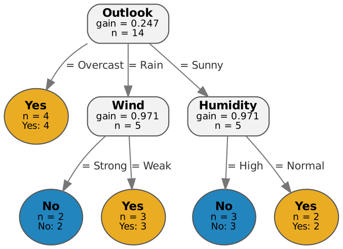
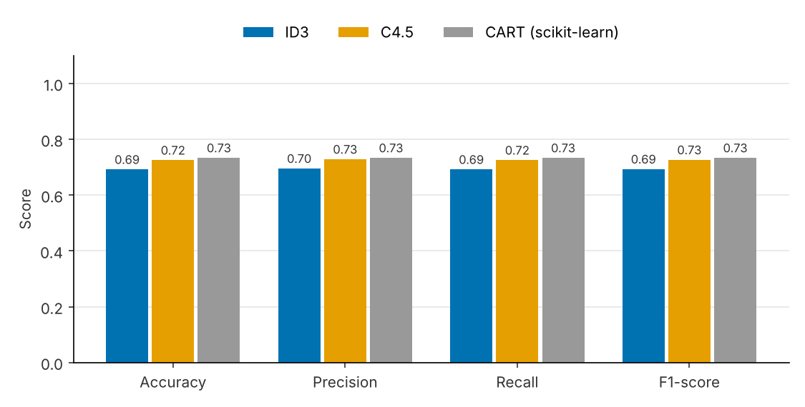

# 🌳 Decision Tree Classification System

An interactive Streamlit application that trains and compares two classic decision-tree
algorithms, **ID3** and **C4.5**, on any classification dataset you upload as a CSV.

Both algorithms are implemented **from scratch with NumPy and Pandas** (see
[`dtree/`](dtree/)). scikit-learn is used for the train/test split, evaluation metrics,
cross-validation and an optional CART reference model; Graphviz draws the trees and
Matplotlib draws the charts.

<p align="center"></p>

## Features

| Stage | What the app does |
|---|---|
| **Upload** | Reads any CSV (delimiter auto-detected). Empty cells, `?`, `NA`, `null` become missing values. Three sample datasets are bundled. |
| **Explore** | Row/column counts, missing cells, duplicates, per-column types and the class distribution. |
| **Target selection** | Pick the class column; warnings for continuous or single-class targets. ID-like columns are suggested for exclusion. |
| **Preprocessing** | Feature-type detection with manual override · missing values imputed, dropped, or handled natively by C4.5 · numeric features discretised for ID3 (equal-width or equal-frequency bins) · stratified train/test split. All statistics are fitted on the training split only. |
| **ID3** | Information gain, multi-way splits, categorical features. |
| **C4.5** | Gain ratio, binary threshold splits on continuous features, fractional-weight handling of missing values, pessimistic error pruning (adjustable confidence factor). |
| **Tree display** | Interactive Graphviz tree with gain / gain ratio per node, colour-coded leaves, depth control for large trees, export to DOT / SVG / PNG, and IF–THEN rules. |
| **Evaluation** | Confusion matrix, accuracy, precision, recall and F1 (weighted, macro or micro), per-class report, downloadable test-set predictions. |
| **Comparison** | Side-by-side metrics chart, tree size and training time, prediction agreement, attribute importance, k-fold cross-validation (mean ± std). |
| **Prediction** | Classify a single example from a form (including missing values, with the decision path shown) or score a whole CSV in batch. |

## Quick start

```bash
git clone https://github.com/<your-username>/decision-tree-classifier.git
cd decision-tree-classifier

python -m venv .venv
source .venv/bin/activate          # Windows: .venv\Scripts\activate
pip install -r requirements.txt

streamlit run app.py
```

The app opens at <http://localhost:8501>. Pick a sample dataset in the sidebar, or upload
your own CSV, choose the target and click **Train ID3 and C4.5**.

> **Graphviz:** the tree is rendered in the browser, so the app works with only the Python
> `graphviz` package. Install the Graphviz system package as well to enable SVG/PNG
> downloads — `sudo apt install graphviz` (Ubuntu), `brew install graphviz` (macOS) or
> `winget install graphviz` (Windows).

### Run the tests

```bash
pytest -q
```

The suite (42 tests) checks the impurity formulas against textbook values, reproduces
the classic Play Tennis ID3 tree, verifies C4.5 thresholds, missing-value handling and
pruning, guards against train/test leakage in preprocessing, and drives the Streamlit
app headlessly with `streamlit.testing`. GitHub Actions runs it on every push
([`.github/workflows/tests.yml`](.github/workflows/tests.yml)).

## Sample datasets

| File | Rows | Features | Why it's included |
|---|---|---|---|
| `data/play_tennis.csv` | 14 | 4 categorical | Textbook ID3 example (Quinlan 1986, Mitchell ch. 3) |
| `data/iris.csv` | 150 | 4 continuous | Shows ID3 binning vs C4.5 threshold splits |
| `data/loan_approval.csv` | 400 | mixed, ~5 % missing | Synthetic data that exercises missing values, an ID column, and pruning |

`scripts/make_sample_data.py` regenerates Iris and the synthetic loan dataset.

## Example result

On the loan dataset (70/30 stratified split, default settings), pruning lets C4.5 build a
tree about five times smaller than ID3's while scoring higher on the test set — ID3 fits
the training data almost perfectly (98.6 %) but generalises worse.

| Model | Accuracy | Precision | Recall | F1 | Nodes |
|---|---|---|---|---|---|
| ID3 | 0.692 | 0.695 | 0.692 | 0.693 | 189 |
| C4.5 | 0.725 | 0.728 | 0.725 | 0.726 | 38 |
| CART (scikit-learn) | 0.733 | 0.733 | 0.733 | 0.733 | 93 |

<p align="center"></p>

## Project structure

```
decision-tree-classifier/
├── app.py                    # Streamlit user interface
├── dtree/                    # Algorithm library (no Streamlit dependency)
│   ├── criteria.py           # entropy, information gain, split info, gain ratio, pruning bound
│   ├── tree.py               # Node, shared fit/predict, rules, importances
│   ├── id3.py                # ID3 classifier
│   ├── c45.py                # C4.5 classifier
│   ├── preprocessing.py      # CSV reading, type detection, imputation, binning, splitting
│   ├── metrics.py            # confusion matrix, accuracy, precision, recall, F1
│   ├── visualize.py          # Graphviz trees, Matplotlib charts
│   └── experiment.py         # train/evaluate/compare, cross-validation, CART reference
├── data/                     # sample datasets
├── docs/
│   ├── ALGORITHMS.md         # theory and worked example
│   ├── ARCHITECTURE.md       # design and data flow
│   ├── USER_GUIDE.md         # how to use the app
│   └── images/
├── scripts/                  # regenerate sample data and figures
├── tests/                    # pytest suite
├── requirements.txt
└── packages.txt              # system packages for Streamlit Community Cloud
```

## Using the library without the UI

```python
import pandas as pd
from dtree import ID3Classifier, C45Classifier, evaluate

df = pd.read_csv("data/play_tennis.csv")
X, y = df.drop(columns=["Day", "PlayTennis"]), df["PlayTennis"]

id3 = ID3Classifier().fit(X, y)
print("\n".join(id3.to_rules()))

c45 = C45Classifier(confidence_factor=0.25).fit(X, y)
print(evaluate(y, c45.predict(X)).as_dict())
```

## Documentation

* [User guide](docs/USER_GUIDE.md) — step-by-step walkthrough of the app
* [Algorithms](docs/ALGORITHMS.md) — ID3 and C4.5 theory, formulas and a worked example
* [Architecture](docs/ARCHITECTURE.md) — module responsibilities and design decisions

## Deploying

The repository is ready for [Streamlit Community Cloud](https://streamlit.io/cloud): point
it at `app.py`; `requirements.txt` and `packages.txt` install everything needed.

## Tech stack

Python · Pandas · NumPy · scikit-learn · Matplotlib · Graphviz · Streamlit · Git / GitHub

## References

* J. R. Quinlan, "Induction of decision trees," *Machine Learning*, 1(1), 1986.
* J. R. Quinlan, *C4.5: Programs for Machine Learning*, Morgan Kaufmann, 1993.
* J. R. Quinlan, "Improved use of continuous attributes in C4.5," *JAIR*, 4, 1996.
* T. M. Mitchell, *Machine Learning*, McGraw-Hill, 1997, ch. 3.

## License

[MIT](LICENSE)
